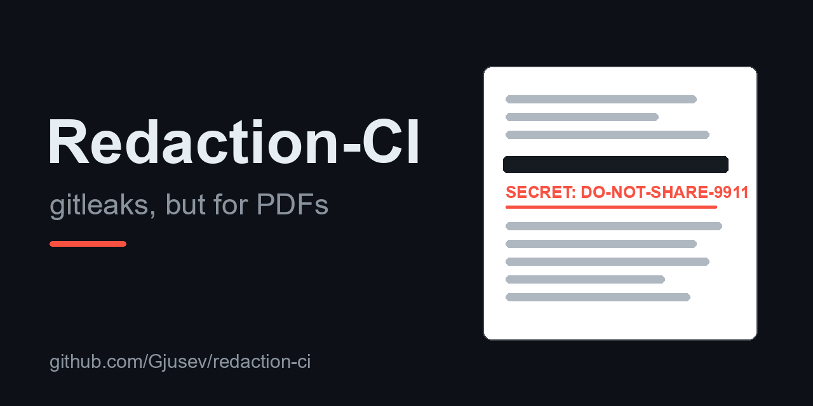

<p align="center">
  
</p>

# Redaction-CI

**gitleaks, but for PDFs.** A GitHub Action that fails the build the moment a
committed PDF still contains the text it pretends to have redacted.

[](https://github.com/Gjusev/redaction-ci/actions/workflows/ci.yml)
[](https://github.com/Gjusev/redaction-ci/releases)
[](LICENSE)

Drawing a black rectangle over a paragraph does not remove the paragraph.
The text stays in the PDF content stream, one copy-paste away for anyone
who opens the file. Redaction-CI catches that before it reaches your
repository, plus every other classic way a "redacted" PDF leaks: unapplied
redaction annotations, invisible or camouflaged text layers, text dragged
off the page, screenshots pasted over live text, filled form fields,
embedded attachments, and earlier revisions left behind by incremental
saves. Built for repositories that hold contracts, invoices, legal
filings and incident reports as PDFs.

```text
[CONFIRMED] contracts/merger-agreement.pdf p1 — 1 extractable text run(s) still
            recoverable under covering box: 'Internal key: DO-NOT-SHARE-9911'
[CONFIRMED] contracts/nda-draft.pdf p1 — redaction annotation present but
            underlying text still extractable (apply_redactions never run):
            'Internal key: DO-NOT-SHARE-9911'
[WARNING  ] press-release.pdf p1 — 1 text run(s) present but never rendered
            (render mode 3): 'Hidden copy: TOPSECRET-4455'
```

Findings land as **inline annotations on the commit/PR** and as a table in
the **job summary**:

| File | Page | Type | Severity | Recoverable text |
| --- | --- | --- | --- | --- |
| `contracts/merger-agreement.pdf` | 1 | covered-text | confirmed | Internal key: DO-NOT-SHARE-9911 |
| `contracts/nda-draft.pdf` | 1 | unapplied-redaction | confirmed | Internal key: DO-NOT-SHARE-9911 |
| `press-release.pdf` | 1 | invisible-text | warning | Hidden copy: TOPSECRET-4455 |

## Quickstart

```yaml
name: Redaction check
on: [push, pull_request]

jobs:
  redaction:
    runs-on: ubuntu-latest
    permissions: contents: read  # the action needs no token
    steps:
      - uses: actions/checkout@v4
      - uses: Gjusev/redaction-ci@v0.2.1
        with:
          paths: |
            contracts/**/*.pdf
            !**/drafts/**
```

That's it: no secrets, no token, no Docker image. The step fails (exit 1)
when a finding matches the `fail-on` policy; by default only confirmed
leaks fail the build, warnings stay visible in annotations and the
summary.

Pin `@v0` to receive v0 fixes automatically, or an exact tag for full
reproducibility (see [releases](#releases)).

## What it detects

| Type | Severity | Meaning |
| --- | --- | --- |
| `covered-text` | **confirmed** | Extractable text sits under a later-drawn, opaque, dark filled box, the classic "x-ray" redaction. |
| `unapplied-redaction` | **confirmed** | A redaction annotation is present but the underlying text is still extractable: the redaction was marked, never applied. |
| `incremental-leftover` | **confirmed*** | The file was saved incrementally after "redacting": earlier revisions are still in the file, and re-scanning them finds the leak. |
| `invisible-text` | warning | Text with PDF render mode 3 or fill opacity ≤ 0.05 that does **not** sit on a placed image. Invisible spans overlapping an image are the OCR layer of a searchable scan and are not flagged. |
| `camouflaged-text` | warning | Text painted the same colour as the box behind it (black-on-black, either paint order) or near-white on the white page: invisible to viewers, extractable by tools. |
| `off-page-text` | warning | Text entirely outside the visible page: never rendered, recoverable by unclipped extractors. |
| `image-covered-text` | warning | Extractable text under a placed, opaque image (screenshot over live text). Paint order is not verified, so this stays a warning. |
| `form-value` | warning | AcroForm fields that still carry values. |
| `attachment` | warning | Embedded file attachments shipping whole extra documents inside the PDF. |
| image-only pages | listed only | Pages with no extractable text at all (scans without OCR). Listed in the job summary; never fails the build. |

\* `incremental-leftover` is a warning when the earlier revision contains
only warnings.

### How the detection works

- **Paint order matters.** A box only "hides" text if it is drawn *after*
  the text in the content stream (`seqno` comparison). Dark panels with
  light text on top (a common, legitimate design) are not flagged, and a
  covered run that is visibly redrawn on top of the panel is suppressed
  as a benign generator quirk. Only a copy painted *on top of* the box
  counts as "visible"; a decoy drawn *under* it does not.
- **The box must be redaction-like.** Filled path, fill opacity ≥
  `min-fill-opacity` (default 0.5), perceived luminance ≤ `max-fill-luma`
  (default 0.85). White-outs are not flagged by default; raise
  `max-fill-luma` to 1.0 to include them.
- **Overlap threshold.** A box must cover at least `min-overlap`
  (default 0.5) of a text run's bounding box to count as hiding it.
- **Fail-closed.** Encrypted PDFs, unparseable files, an explicitly empty
  or negation-only `paths` input, an explicit glob that matches nothing,
  and excludes that remove every matched file all fail the step (exit 2):
  an unverifiable or empty scan is not a clean scan. Repos with no PDFs
  at all pass.

The detector uses the same primitives an attacker would (text extraction,
drawing geometry, revision recovery), so what it flags is what standard
text extractors can recover.

## Inputs

| Input | Default | Description |
| --- | --- | --- |
| `paths` | `**/*.pdf` | Newline-separated glob(s) relative to the repo root; a line starting with `!` excludes that glob. Matching is case-insensitive (`.PDF` is caught too). An explicit glob that matches nothing fails the scan (typos must not pass silently); the default glob passes on repos with no PDFs. |
| `exclude` | *(empty)* | Newline-separated glob(s) to exclude. Excludes that remove every matched file fail the scan. |
| `fail-on` | `confirmed` | `confirmed` fails only on covered text, unapplied redactions and recoverable earlier revisions. `any` also fails on invisible/camouflaged text, form values, attachments and the other warnings. |
| `max-fill-luma` | `0.85` | Perceived luminance (0..1) a fill may have at most to count as a redaction box. Lower = only dark boxes; `1.0` also flags white-outs. |
| `min-overlap` | `0.5` | Fraction of a text run's bbox a box must cover. |
| `min-fill-opacity` | `0.5` | Minimum fill opacity to count as covering. |
| `format` | `text` | stdout format of the scan step: `text` or `json` (machine-readable; annotations then go to stderr). |

## Outputs

`findings`, `confirmed`, `warnings`, `files`, `pages`,
`files-with-findings`, `matched`, usable via step `id` and
`${{ steps.<id>.outputs.confirmed }}` etc. `matched` is `"true"` when
findings matched the fail-on policy (the step then exits non-zero: 1 on
findings, 2 on scan errors).

### Recipes

**Fail on warnings too** (strict mode: also fails on invisible, camouflaged,
off-page and image-covered text, form values and attachments):

```yaml
      - uses: Gjusev/redaction-ci@v0.2.1
        with:
          fail-on: any
```

**Comment the findings on the PR instead of failing** (or as well as):

```yaml
      - uses: Gjusev/redaction-ci@v0.2.1
        id: redaction
        continue-on-error: true
      - if: github.event_name == 'pull_request' && steps.redaction.outputs.matched == 'true'
        uses: actions/github-script@v7
        with:
          script: |
            const r = ${{ toJSON(steps.redaction.outputs) }};
            await github.rest.issues.createComment({
              ...context.repo,
              issue_number: context.issue.number,
              body: `**Redaction-CI**: ${r.confirmed} confirmed, ${r.warnings} warning(s) across ${r['files-with-findings']} PDF(s). See the job summary.`
            });
```

**Machine-readable output** for downstream tooling:

```yaml
      - uses: Gjusev/redaction-ci@v0.2.1
        id: redaction
        continue-on-error: true
        with:
          format: json
```

The scan step's stdout is then a single JSON document (`findings`,
`files_scanned`, `pages_scanned`, `image_only_pages`, `errors`).

## Privacy & security

- **Nothing leaves your runner.** The detector is one readable Python
  file executed on your own machine; it makes no network calls, needs no
  token and no secrets. Annotations and the job summary use runner
  primitives (`::error` workflow commands, `$GITHUB_STEP_SUMMARY`).
- **Inputs reach the script via `env:`**, never interpolated into the
  shell, so wiring `paths` to untrusted context (PR changed-file lists,
  `workflow_dispatch` inputs) cannot inject shell code.
- **Dependencies are pinned**: `actions/checkout` and `actions/setup-python`
  by commit SHA, PyMuPDF by exact version.
- Unreadable or encrypted PDFs **fail the scan** (exit 2): an
  unverifiable PDF is not a clean PDF.

## Honest limitations

Read this section before trusting a green check with your life.

- **Scanned/image PDFs without an OCR layer are not verified.** If the
  "redacted" page is a bitmap with no text at all, there is nothing to
  check. OCR-based verification is deliberately out of scope: a wrong
  OCR-based "all clear" is worse than an honest "cannot verify". (A scan
  *with* an OCR layer is verified through that layer, which is exactly
  what an attacker would extract.)
- **Image-over-text is a warning tier.** Text under a placed image is
  flagged by geometry only (the extraction API does not expose image
  paint order), so a caption drawn over a photo can also trigger it. It
  never fails a build under the default `fail-on: confirmed`.
- **Detection is heuristic.** Paint order, fill colour, opacity and
  overlap are strong signals, not proof. Unusual colour spaces (spot
  colours, ICC) can produce false negatives; CMYK luminance is
  approximated. Stacked semi-transparent boxes, each below
  `min-fill-opacity`, are not combined.
- **Opaque stamps over live text** (a black "DRAFT" stamp, a banner) are
  indistinguishable from a fake redaction by geometry alone: the text
  under them really is recoverable. If you stamp documents, expect a
  confirmed finding and exclude or adjust for those files.
- **Out of scope:** document metadata (no way to tell "sensitive" from a
  producer string), JavaScript/OpenAction, and anything outside the
  text/drawing/revision model of the page.
- **A green check is not a redaction certificate.** If the stakes are
  high, render the page to an image and *look at it* (or run a proper
  redaction tool like PyMuPDF's `apply_redactions()`, which actually
  removes content) before publishing.

## Why composite, not Docker

This is a **composite action** (Python + [PyMuPDF](https://pypi.org/project/pymupdf/),
pinned in `requirements.txt`) rather than a `docker://` container:

- **No image to build, publish, or patch.** A `docker://` action needs a
  registry image rebuilt for every detector fix, and that pipeline
  silently drifts from the code you can read here.
- **Transparent**: the whole detector is one readable Python file, and a
  composite action runs exactly that file on your runner.
- **Fast**: no image pull; `pip install` of the pinned wheel takes
  seconds.
- **Portable**: the test suite covers ubuntu, windows and macos runners.

## Releases

- Exact tags (`v0.2.0`, …) are immutable release points; the quickstart
  pins one for reproducibility.
- A moving major tag (`v0`) is force-updated to the latest release by the
  [release workflow](.github/workflows/release.yml); pin it to receive
  v0 fixes and features automatically.
- Changes, including breaking ones, are documented in
  [CHANGELOG.md](CHANGELOG.md).

## Support

The action is free, open source and MIT-licensed. If it flags a document
you believe is clean, or misses a leak you can demonstrate, [open an
issue](https://github.com/Gjusev/redaction-ci/issues) with the PDF or a
script that rebuilds it; confirmed false negatives become test cases.
By @Gjusev, [datenmaske.de](https://datenmaske.de).

## License

Redaction-CI's own code is MIT; see [LICENSE](LICENSE). The detection
dependency **PyMuPDF is AGPL-3.0** and is installed from PyPI at run
time, not vendored or modified; its license terms apply to PyMuPDF
itself. If your project cannot accept an AGPL dependency at run time,
please file an issue: a pdfplumber-based (MIT) fallback is possible but
would lose render-mode detection, the invisible-text check and revision
recovery.

## Development

Python **≥ 3.11** is required (the pinned `pymupdf==2.0` wheel is
cp311-abi3; CI tests Python 3.11 to 3.13, and the action itself runs
3.12):

```sh
python3.12 -m venv .venv && .venv/bin/pip install -r requirements.txt pytest ruff
.venv/bin/python -m pytest tests/ -q          # unit + fixture tests
.venv/bin/python tests/make_fixtures.py       # regenerate fixtures/*.pdf
.venv/bin/ruff check .                        # lint
```

The repo's own CI [dogfoods the action](.github/workflows/ci.yml): clean
fixtures (including a legitimate OCR scan and a benign white-redraw
panel) must pass, the fake-redaction fixtures must fail, and the
invisible-text fixture must respect both `fail-on` modes.

---
by @Gjusev · datenmaske.de
